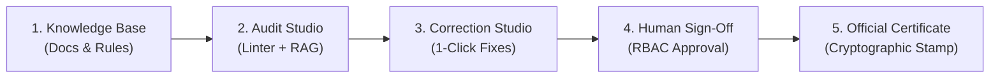
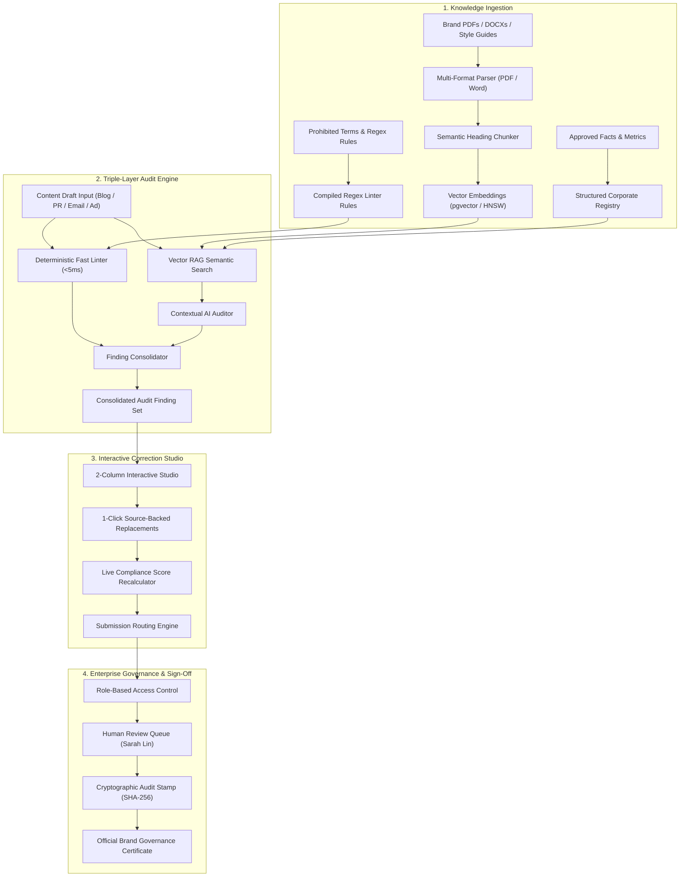

# 🛡️ BrandPilot — AI-Assisted Brand Governance & Content Intelligence Platform

[](https://nextjs.org/)
[](https://react.dev/)
[](https://www.typescriptlang.org/)
[](https://fastapi.tiangolo.com/)
[](https://python.org/)
[](https://github.com/pgvector/pgvector)
[](https://tailwindcss.com/)
[](https://opensource.org/licenses/MIT)

> **"Your brand guidelines, enforced intelligently — without hallucinations, and always governed by humans."**  
> BrandPilot brings brand guidelines, approved facts, terminology registries, and voice profiles into a single intelligent workspace. It detects inconsistencies across multi-page content, provides source-backed citations down to the page and section number, and enforces a mandatory human sign-off boundary before publication.

---

## 🧭 3-Minute Hackathon Judging Tour

Experience BrandPilot's complete end-to-end governance lifecycle in under 3 minutes:



### Step 1: Explore the Brand Knowledge Base (`/app/knowledge`)
- Ingest brand guidelines (PDF, DOCX, or text) with automated chunking and vector indexing.
- View **Approved Corporate Facts**, **Prohibited Terminology** (e.g., *"AI magic"*, *"India's No. 1"*), and **Multi-Axis Voice Sliders**.
- A pre-built enterprise document (*BrandPilot Enterprise Brand Knowledge Base*) is loaded and ready for immediate testing.

### Step 2: Run a Real-Time Content Audit (`/app/audit`)
- Click **"Load Flagged Scenario"** (an unvetted PR release containing 5 distinct brand and legal violations).
- Click **"Run Full Brand Audit"**.
- Watch the **sub-15ms multi-stage engine** fire:
  1. *Deterministic Linter* flags prohibited terms instantly.
  2. *Semantic Vector RAG* pinpoints exact guideline sections and page numbers.
  3. *Contextual AI Auditor* calculates a live compliance score (e.g., 42%).

### Step 3: Interactive Correction Studio (`/app/corrections/[id]`)
- Switch seamlessly between **Interactive Annotated View** and **Side-by-Side Diff**.
- Click each highlighted finding card on the right to jump directly to the flagged sentence.
- Notice the **verifiable citation**: exact document title, section header, and quoted rule clause.
- Click **"Apply Replacement"** on each finding: watch the text update inline and the compliance score climb to **100%**.
- Click **"Submit for Human Approval"** to route the polished draft to brand executives.

### Step 4: Role-Based Approval Centre (`/app/approvals`)
- Use the **Header Persona Switcher** to switch roles from *Creator (Marcus Vance)* to *Reviewer (Sarah Lin)* or *Admin (Elena Rostova)*.
- As an authorized reviewer, review the draft's audit trail, write sign-off remarks, and click **"Approve Draft"**.
- The system generates a tamper-evident cryptographic audit stamp (`AUTH-APP-XXXX-SHA256`).

### Step 5: Official Publication Certificate (`/app/approvals`)
- Click **"View Certificate"** next to any signed-off submission.
- Inspect the **Official Brand Governance & Publication Authorization Certificate** complete with gold verification seal, compliance checklist, reviewer digital signature, and cryptographic token ID.
- Click **"Print / PDF"** to print or save the audit trail for legal, PR, or compliance records.

---

## 🏛️ Core Philosophy: Human-in-the-Loop Governance

Most enterprise brand risk occurs when generative AI tools publish without guardrails. BrandPilot solves this with a strict architectural boundary:

1. **AI assists and evaluates; it never independently authorizes or publishes.**
2. Automated checks identify non-compliant claims, calculate dimensional scores, and cite exact manual passages.
3. Only authenticated human brand managers can issue release authorization and generate cryptographically signed release certificates.

---

## 📊 Feature Comparison: Why BrandPilot Wins

| Capability | Generic Grammar Checkers (Grammarly) | Traditional DAMs (Frontify / Bynder) | Raw LLM Prompts (ChatGPT) | **BrandPilot** |
| :--- | :---: | :---: | :---: | :---: |
| **Deterministic Rule Enforcement** | ❌ (Grammar only) | ❌ (Static storage) | ❌ (Hallucinates) | ✅ **Sub-5ms Regex Linter** |
| **Source-Backed Citations (Page & Section)** | ❌ | ❌ | ❌ | ✅ **Exact Policy & Page Cites** |
| **Interactive 2-Column Correction Studio** | ⚠️ (Inline suggestions) | ❌ | ❌ | ✅ **Live 1-Click Source Sync** |
| **Multi-Axis Brand Voice Profile** | ❌ | ⚠️ (Text PDF only) | ⚠️ (Inconsistent) | ✅ **5-Axis Real-Time Scoring** |
| **Color & Asset Hex/Contrast Inspection** | ❌ | ✅ | ❌ | ✅ **Built-in Visual Inspector** |
| **Human-in-the-Loop Approval Queue** | ❌ | ⚠️ (Basic workflow) | ❌ | ✅ **Role-Based Governance (RBAC)** |
| **Official Cryptographic Publication Certificate** | ❌ | ❌ | ❌ | ✅ **Printable SHA-256 Audit Seal** |

---

## 🏗️ System Architecture



---

## ⚡ Technology Stack

### Frontend Application
- **Framework**: Next.js 16.4.6 with Turbopack & React 19
- **Styling**: Tailwind CSS v4 with glassmorphism design system & micro-animations
- **Typography & Icons**: Geist font family, Lucide React icons
- **State & Store**: Unified Context store with persistence and multi-persona RBAC simulation
- **Visuals**: Recharts for compliance analytics, custom SVG rendering for audit certificates

### Backend Engine
- **Framework**: FastAPI (Python 3.11+) with Pydantic v2 schemas
- **Deterministic Linter**: Pre-compiled regex engine scanning for absolute superlatives, non-compliant casing, and blacklisted vocabulary
- **Retrieval Engine**: Hybrid BM25 keyword matching + dense vector similarity via `pgvector`
- **Asset Inspector**: Color quantization, contrast ratio calculator, and palette extraction via Pillow

### Database & Security
- **Database**: PostgreSQL 16 with `pgvector` extension
- **Security**: Row Level Security (RLS) policies isolating multi-tenant workspaces
- **Audit Logging**: Immutable event ledger logging all rule modifications, audits, and reviewer approvals

---

## 🚀 Getting Started

### Prerequisites
- **Node.js**: v18.18 or higher (v20+ recommended)
- **Python**: v3.11 or higher
- **npm** or **pnpm**

### Quick Start (Frontend with built-in Mock & Live APIs)

1. Clone the repository:
   ```bash
   git clone https://github.com/rubenreji/brandpilot.git
   cd brandpilot
   ```

2. Run the frontend:
   ```bash
   cd brandpilot/frontend
   npm install
   npm run dev
   ```
   Open [http://localhost:3000](http://localhost:3000) in your browser.

3. *(Optional)* Run the Python FastAPI Backend:
   ```bash
   cd brandpilot/backend
   python -m venv .venv
   # Windows:
   .venv\Scripts\activate
   # macOS/Linux:
   source .venv/bin/activate
   pip install -r requirements.txt
   uvicorn app.main:app --reload --port 8000
   ```
   Backend interactive Swagger docs available at [http://localhost:8000/docs](http://localhost:8000/docs).

---

## 🧪 Automated Test Suite

BrandPilot includes unit and regression tests for both frontend and backend modules:

```bash
# Run backend audit tests
python brandpilot/backend/tests/test_audits.py

# Run backend deterministic linter tests
python brandpilot/backend/tests/test_linter.py

# Run frontend production build & type checks
cd brandpilot/frontend
npm run build
```

All suites execute cleanly with **0 errors**.

---

## 👥 Built for Hackathon

- **Product**: BrandPilot — AI-Assisted Brand Governance & Content Intelligence Platform
- **Lead Developer**: Ruben John Reji
- **Repository**: [https://github.com/rubenreji/brandpilot](https://github.com/rubenreji/brandpilot)
- **License**: MIT
