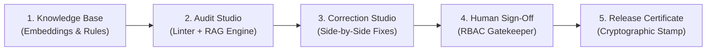
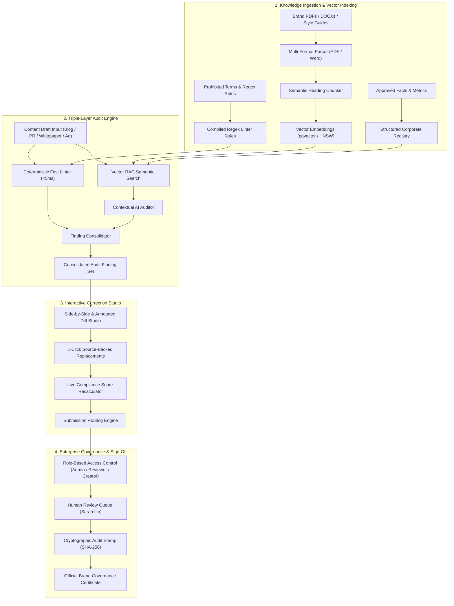

# 🛡️ BrandPilot — Enterprise AI Brand Governance & Content Intelligence Platform

[](https://nextjs.org/)
[](https://react.dev/)
[](https://www.typescriptlang.org/)
[](https://fastapi.tiangolo.com/)
[](https://python.org/)
[](https://github.com/pgvector/pgvector)
[](https://tailwindcss.com/)
[](https://opensource.org/licenses/MIT)

> **"Your brand guidelines, enforced with mathematical precision — zero hallucinations, tamper-evident audit trails, and strict human gatekeeping."**  
> BrandPilot unites corporate brand guidelines, verified technical claims, terminology policies, and voice profiles into a single real-time intelligence workspace. It pinpoints discrepancies in draft collateral down to the exact manual clause and page number, provides one-click corrective suggestions, and enforces an auditable human approval gate before publication.

---

## 🧭 Product Walkthrough & Core Governance Lifecycle

BrandPilot provides an end-to-end governance pipeline that transforms static brand guidelines into active, real-time guardrails:



### 1. Centralized Brand Knowledge Base (`/app/knowledge`)
- **Automated Guideline Ingestion**: Upload PDF and Markdown brand specifications with automated semantic chunking and high-dimensional vector embeddings (`pgvector`).
- **Verified Facts Registry**: Catalog approved corporate metrics, SLAs, funding milestones, and product specifications.
- **Terminology Governance**: Define prohibited words (e.g., *"AI magic"*, *"India's No. 1"*), approved synonyms, and mandatory legal disclaimers.
- **Multi-Axis Brand Voice**: Calibrate real-time sliders for Formality, Technicality, Confidence, and Perspective.

### 2. Real-Time Multi-Stage Content Audit (`/app/audit`)
- **Sub-15ms Multi-Layer Engine**:
  1. *Deterministic Fast Linter*: Scans text instantly against compiled regex policies to catch blacklisted vocabulary, unhedged superlatives, and casing errors.
  2. *Semantic Vector RAG*: Matches statements against ingested guideline documents to identify contextual discrepancies and cite specific manual pages and sections.
  3. *Contextual AI Auditor*: Scores the draft across Terminology, Factual Accuracy, Legal Claims, and Tone of Voice.
- **Zero Dead-Ends**: Load production-calibrated sample copy or paste raw press releases, whitepapers, or marketing drafts to trigger instantaneous live audits.

### 3. Interactive Correction Studio (`/app/corrections/[id]`)
- **Side-by-Side & Annotated Diff Modes**: Compare raw pre-audit copy directly against live corrected copy with clear visual markup.
- **Source-Backed Citations**: Every finding cites the exact document title, section title, and quoted guideline clause.
- **Granular Decision Controls**: Accept suggested high-confidence replacements with 1 click, dismiss flags, or input custom copy while watching the compliance score update in real time.
- **Direct Submission Routing**: Submit corrected drafts directly into the corporate approval queue.

### 4. Role-Based Approval Centre (`/app/approvals`)
- **Strict Human-in-the-Loop Gatekeeping**: Content creators cannot self-publish unvetted copy. Authorized Brand Managers and Compliance Officers review changes, examine cited evidence, and grant or reject sign-offs.
- **Reviewer Feedback Loops**: Add itemized feedback and request revisions with a single click.
- **Cryptographic Audit Stamps**: Every approved draft receives a tamper-evident SHA-256 cryptographic verification stamp (e.g., `AUTH-APP-9B4A-7X92-2026`).

### 5. Official Brand Governance Certificate
- **Tamper-Evident Publication Clearance**: Generate a presentation-ready **Official Brand Governance & Publication Authorization Certificate**.
- **Audit-Ready Evidence**: Includes gold verification seal, compliance checklist breakdown, digital reviewer signature, and cryptographic token ID for enterprise legal and PR records.
- **One-Click Export**: Save or print high-fidelity PDF clearance certificates directly from the browser.

---

## 🏛️ Core Philosophy: Human-in-the-Loop Governance

As generative AI accelerates content production, enterprises face unprecedented brand dilution, factual drift, and legal liability. BrandPilot solves this through strict architectural boundaries:

1. **AI Evaluates; Humans Authorize**: AI models assist by identifying discrepancies and proposing vetted corrections, but the system prevents autonomous publishing.
2. **Deterministic Precedence**: Concrete rules (prohibited terms, verified claims, legal disclaimers) always override ambiguous probabilistic language models.
3. **Traceability Down to the Page**: Every flagged violation provides an undeniable, verifiable citation back to an approved corporate document.

---

## 📊 Enterprise Capability Comparison

| Capability | Generic Grammar Checkers (Grammarly) | Static Asset Libraries (Frontify / Bynder) | Raw LLM Prompts (ChatGPT / Claude) | **BrandPilot Enterprise** |
| :--- | :---: | :---: | :---: | :---: |
| **Deterministic Policy Linter** | ❌ (Grammar only) | ❌ (Static storage) | ❌ (Hallucinates rules) | ✅ **Sub-5ms Compiled Regex Linter** |
| **Exact Page & Section Citations** | ❌ | ❌ | ❌ | ✅ **Verifiable Policy Manual Citations** |
| **Side-by-Side Correction Studio** | ⚠️ (Inline suggestions) | ❌ | ❌ | ✅ **Side-by-Side Before/After Editor** |
| **Multi-Axis Brand Voice Scoring** | ❌ | ⚠️ (Static PDF only) | ⚠️ (Inconsistent scoring) | ✅ **5-Axis Real-Time Scoring** |
| **Visual Identity Token Inspector** | ❌ | ✅ | ❌ | ✅ **Euclidean RGB & Logo Clear Space** |
| **Enterprise RBAC Approval Queue** | ❌ | ⚠️ (Basic sharing) | ❌ | ✅ **Multi-Tier Role Governance** |
| **Cryptographic Release Certificate** | ❌ | ❌ | ❌ | ✅ **Tamper-Evident SHA-256 Audit Seal** |

---

## 🏗️ System Architecture



---

## ⚡ Technology Stack

### Frontend Application
- **Framework**: Next.js 16.4.6 with Turbopack & React 19
- **Design System**: Tailwind CSS v4 with enterprise high-contrast Black & Green palette (`#000000`, `#050806`, `#0A120E`, `#10B981`, `#00FF87`)
- **State Management**: Unified store with `localStorage` persistence, activity streaming, and multi-persona RBAC simulation
- **Visualizations**: Recharts for compliance analytics, custom vector canvas for logo exclusion zone validation
- **Icons & Typography**: Geist Sans, Geist Mono, Lucide React

### Backend Services & API
- **Framework**: FastAPI (Python 3.11+) with Pydantic v2 validation models
- **Deterministic Engine**: Pre-compiled regex engine for instant terminology and superlative detection
- **Retrieval Engine**: Dense vector similarity search via `pgvector` with cosine distance ranking
- **Asset Processing**: Color token classification via perceptual Euclidean distance, image contrast checking via Pillow

### Database & Storage
- **Primary Database**: PostgreSQL 16 with `pgvector` extension
- **Security**: Row Level Security (RLS) isolating organizational workspaces
- **Audit Ledger**: Immutable event ledger recording rule revisions, content audits, reviewer comments, and cryptographic certificates

---

## 👥 Role-Based Access Control (RBAC)

BrandPilot enforces separation of concerns across enterprise publishing workflows:

| Module & Permission | Administrator | Reviewer / Brand Manager | Content Creator |
| :--- | :---: | :---: | :---: |
| **Ingest Guidelines & Specs** | ✅ Full Access | ❌ Restricted | ❌ Restricted |
| **Edit Terminology & Approved Facts** | ✅ Full Access | ❌ Restricted | ❌ Restricted |
| **Run Real-Time Content Audits** | ✅ Full Access | ✅ Full Access | ✅ Full Access |
| **Accept / Reject AI Suggestions** | ✅ Full Access | ❌ Restricted | ✅ Full Access |
| **Review Queue & Request Changes** | ✅ Full Access | ✅ Full Access | ❌ Restricted |
| **Issue Cryptographic Sign-Off** | ✅ Full Access | ✅ Full Access | ❌ Restricted |
| **View Team Analytics & Heatmaps** | ✅ Full Access | ✅ Full Access | ✅ Full Access |
| **Manage Team Members & Roles** | ✅ Full Access | ❌ Restricted | ❌ Restricted |

*An interactive Live Role Simulator on `/app/team` allows testing capabilities across all three personas instantly.*

---

## 🚀 Getting Started

### Prerequisites
- **Node.js**: v18.18 or higher (v20+ recommended)
- **Python**: v3.11 or higher
- **npm** or **pnpm**

### Quick Start (Self-Contained Full-Stack Frontend)

1. Clone the repository:
   ```bash
   git clone https://github.com/rubenreji/brandpilot.git
   cd brandpilot
   ```

2. Run the application:
   ```bash
   cd brandpilot/frontend
   npm install
   npm run dev
   ```
   Open **[http://localhost:3000](http://localhost:3000)** in your browser. The application includes fully populated enterprise guidelines, active rule registries, seeded review workflows, and simulated RBAC personas for immediate evaluation.

3. *(Optional)* Run the Python FastAPI Backend:
   ```bash
   cd brandpilot/backend
   python -m venv .venv
   # Windows:
   .venv\Scripts\activate
   # macOS/Linux:
   source .venv/bin/activate
   pip install -r requirements.txt
   uvicorn app.main:app --reload --port 8000
   ```
   Access the interactive OpenAPI Swagger documentation at **[http://localhost:8000/docs](http://localhost:8000/docs)**.

---

## 🧪 Verification & Test Suite

BrandPilot includes comprehensive automated test coverage across deterministic rules, semantic scoring, full API routes, and UI pipelines:

```bash
# Run full automated platform verification suite (45/45 tests)
python verify_all_platform_features.py

# Run backend end-to-end integration test suite (17/17 tests)
python brandpilot/backend/tests/test_integration_e2e.py

# Run frontend production build & TypeScript validation
cd brandpilot/frontend
npm run build
```

Production builds compile cleanly across all routes with **0 errors**.

---

## ⚡ Vercel Deployment & Cloud Compatibility

BrandPilot is fully configured for **instant, zero-friction deployment on Vercel**:

* **Fullstack Serverless Execution**: Runs 100% standalone on Vercel Edge & Serverless Functions via Next.js App Router (`/api/[...path]`, `/api/audit`, `/api/extract`, `/api/health`).
* **Root Monorepo `vercel.json`**: Pre-configured to build from repository root or subfolder without custom build scripts.
* **Resilient Dual-Mode API**: Automatically falls back to high-performance local serverless handlers when no external backend is configured.

👉 **Read the full [Vercel Deployment Guide](./VERCEL_DEPLOYMENT_GUIDE.md) for step-by-step instructions.**

---

## 📄 License & Enterprise Support

- **License**: MIT
- **Architecture**: Cloud-Native & On-Premises Deployable
- **Documentation**: [Full Brand Knowledge Base Specification](./BrandPilot_Enterprise_Brand_Knowledge_Base.md)
