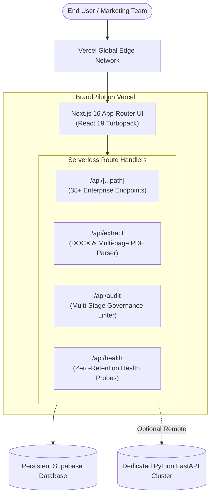

# 🚀 BrandPilot — Vercel Deployment & Compatibility Guide

BrandPilot is fully architected for **zero-friction, production deployment on Vercel**. You can deploy the complete multi-tenant, AI-governed brand intelligence platform in minutes with full serverless execution.

---

## ⚡ Quick Deployment Options

### Option A: Standard Deployment from Git Repository Root (Recommended)
BrandPilot includes a root-level `vercel.json` and monorepo scripts configured for Vercel's build container:

1. Push your repository to GitHub, GitLab, or Bitbucket.
2. Go to [Vercel Dashboard](https://vercel.com/new) and click **"Import Project"**.
3. Select this repository.
4. **Leave Root Directory as `.` (default)**. Vercel automatically detects `vercel.json`:
   * **Framework Preset**: Next.js
   * **Install Command**: `npm --prefix brandpilot/frontend install`
   * **Build Command**: `npm --prefix brandpilot/frontend run build`
   * **Output Directory**: `brandpilot/frontend/.next`
5. Configure Environment Variables (see below) and click **Deploy**.

---

### Option B: Deploying with Root Directory set to `brandpilot/frontend`
If your team prefers pointing Vercel directly to the Next.js directory:

1. In Vercel Project Settings under **"Root Directory"**, enter:
   ```
   brandpilot/frontend
   ```
2. Vercel will automatically read `brandpilot/frontend/vercel.json` and build the application cleanly.
3. Configure Environment Variables and click **Deploy**.

---

## 🔐 Environment Variables Configuration

Set these variables in your **Vercel Project Settings → Environment Variables**:

| Variable Name | Required | Default / Description |
| :--- | :---: | :--- |
| `NEXT_PUBLIC_SUPABASE_URL` | **Yes** | Your Supabase project URL (e.g. `https://your-project.supabase.co`) |
| `NEXT_PUBLIC_SUPABASE_ANON_KEY` | **Yes** | Your Supabase anonymous/publishable key |
| `SUPABASE_SERVICE_ROLE_KEY` | Optional | Admin secret key for automated schema provisioning |
| `NEXT_PUBLIC_APP_NAME` | Optional | `"BrandPilot"` |
| `NEXT_PUBLIC_API_URL` | Optional | **Leave blank for 100% serverless Next.js execution on Vercel.** If connecting to a remote Python FastAPI instance (e.g. on Fly.io, Render, AWS), provide `https://api.yourbrandpilot.com/api`. |
| `BACKEND_URL` | Optional | Internal server-to-server proxy target if using a dedicated Python cluster. |

> [!NOTE]
> If `NEXT_PUBLIC_API_URL` is omitted, BrandPilot automatically activates its **Serverless Next.js Route Engine** (`/api/[...path]`). Every single feature—including the Visual Compliance Studio, Multi-Vector Auditing, In-Situ Linter, and Cryptographic Stamp Generator—runs natively on Vercel Serverless Functions with zero external hosting required!

---

## 🏛️ Vercel Architecture Overview



---

## 🛠️ Local Verification

Before deploying, you can verify your build locally using the exact commands Vercel executes:

```bash
# 1. Install dependencies
npm --prefix brandpilot/frontend install

# 2. Run Next.js production build
npm --prefix brandpilot/frontend run build

# 3. Start production server locally
npm --prefix brandpilot/frontend run start
```

All 22 routes compile statically and dynamically with **0 build errors**.
